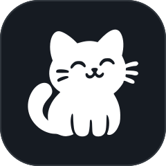
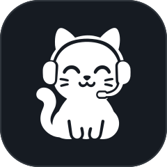

---

### 🚀 Projetos

<table>
<tr>
<td width="140" align="center" valign="middle"></td>
<td valign="middle">

#### 📺 BemCat
Player IPTV para Windows (Xtream Codes e M3U), com início no estilo Apple TV, efeito acrílico do Windows 11, player completo e **controle pelo celular via QR Code**.

</td>
</tr>
<tr>
<td width="140" align="center" valign="middle"></td>
<td valign="middle">

#### 🎫 BemSup
Sistema de chamados integrado ao **GLPI** e a uma **IA local**: responde parte dos chamados sozinho e monta um **banco de soluções** para agilizar o atendimento.

</td>
</tr>
</table>

---

### 📊 Estatísticas

### 🎧 Tocando agora

### 🐍 Contribuições

<picture>
  <source media="(prefers-color-scheme: dark)" srcset="https://raw.githubusercontent.com/paulomeier/paulomeier/output/github-snake-dark.svg" />
  <source media="(prefers-color-scheme: light)" srcset="https://raw.githubusercontent.com/paulomeier/paulomeier/output/github-snake.svg" />
  
</picture>

